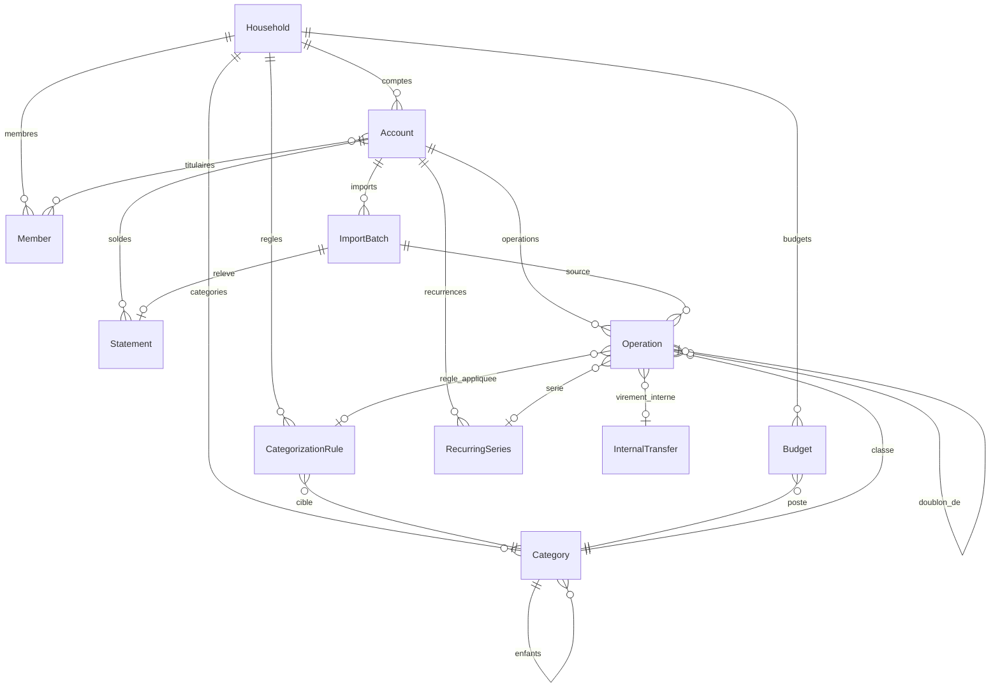

# Modèle de données

Montants en **centimes** (entiers, négatif = débit, cf. ADR 0004). Numéros de compte jamais stockés en clair : seulement un HMAC (`numberHash`, secret `ACCOUNT_NUMBER_PEPPER`) et un masque (`****R999`).

| Entité | Rôle | Points clés |
|---|---|---|
| `Household` | Foyer (un seul) | racine de tout |
| `Member` | Personne + utilisateur de connexion | `username` unique, mot de passe optionnel jusqu'à l'étape 7 |
| `Account` | Compte bancaire | `alias` unique par foyer, type `personal`/`joint`, titulaires 1..n |
| `ImportBatch` | Un fichier importé | `sha256` unique → un fichier n'est jamais importé deux fois |
| `Statement` | Soldes d'un relevé | ouverture (PDF) / clôture ; sert au contrôle de cohérence et à l'historique de solde |
| `Operation` | Ligne de relevé | `fingerprint` unique (compte, date, montant, libellé normalisé, rang d'occurrence) ; index GIN `pg_trgm` sur `normalized_label` ; statut de doublon probable |
| `Category` | Poste de dépense/revenu, arbre à 2 niveaux | `kind` : `expense` / `income` / `transfer` (exclu des dépenses) ; unicité (foyer, parent, nom) avec `NULLS NOT DISTINCT` |
| `CategorizationRule` | Règle automatique | champ commerçant/libellé, contient/commence par/exact/regex, sens, bornes de montant (valeur absolue), compte optionnel, priorité ; `matches()` pur et testé |
| `InternalTransfer` | Paire de virements entre comptes du foyer | exclue des stats consolidées |
| `Budget` | Budget mensuel d'un poste | portée foyer / personne / compte |
| `RecurringSeries` | Dépense/revenu récurrent détecté | fréquence, montant attendu ± tolérance, prochaine échéance |

## Commandes
- `make sf c='app:setup'` : crée le foyer et l'arbre de 62 catégories par défaut (`src/Setup/DefaultCategories.php`). Idempotente.
- `make sf c='app:member:add <identifiant> "<Nom affiché>"'` : ajoute une personne (mot de passe demandé, ou plus tard).
